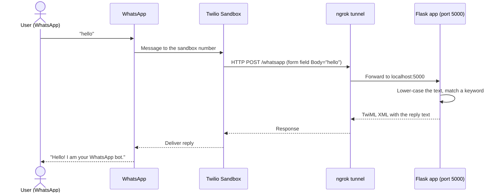
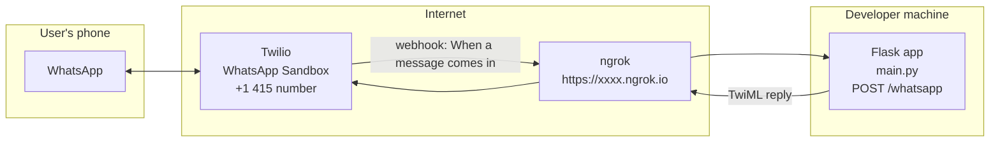
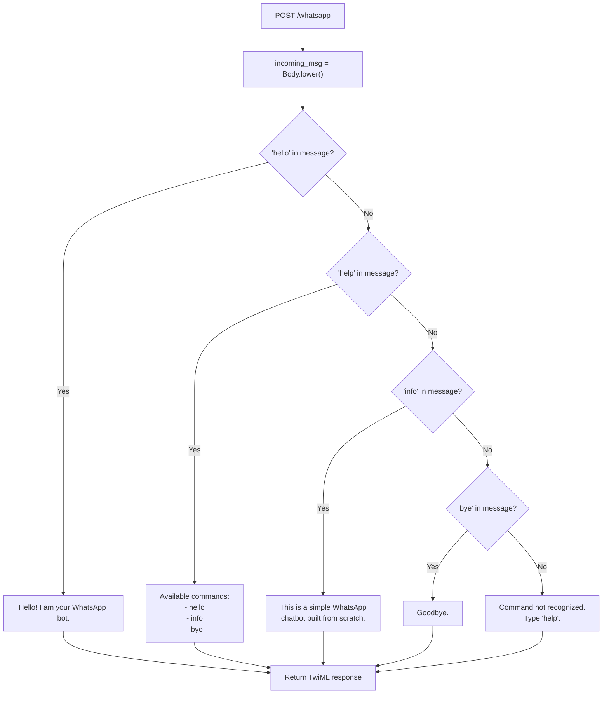

# WhatsApp Chatbot (Flask + Twilio)

A small, rule-based **WhatsApp chatbot**. A user sends a message to a Twilio WhatsApp number; Twilio forwards it to a Flask web server over HTTPS; the server picks a reply based on keywords and sends it back. It is a learning project that shows the complete round trip of a WhatsApp bot, with the smallest amount of code possible (a single 26-line file).

---

## Table of contents

1. [What it does](#what-it-does)
2. [How a message travels](#how-a-message-travels)
3. [Architecture](#architecture)
4. [Decision logic](#decision-logic)
5. [Commands](#commands)
6. [Project structure](#project-structure)
7. [Setup and run](#setup-and-run)
8. [Code walkthrough](#code-walkthrough)
9. [Troubleshooting](#troubleshooting)
10. [Extending the bot](#extending-the-bot)
11. [Security notes](#security-notes)
12. [Limitations and next steps](#limitations-and-next-steps)

---

## What it does

- Receives WhatsApp messages through the **Twilio WhatsApp Sandbox**.
- Replies to four keywords (`hello`, `help`, `info`, `bye`) and gives a fallback message for everything else.
- Runs locally; **ngrok** exposes the local server to the internet so Twilio can reach it during development.

| Technology | Role |
|---|---|
| Python 3.7+ | Language |
| Flask | Web server that exposes the `/whatsapp` webhook |
| Twilio API for WhatsApp | Delivers messages between WhatsApp and the webhook |
| TwiML (`MessagingResponse`) | The XML reply format Twilio understands |
| ngrok | Public HTTPS tunnel to `localhost:5000` |

---

## How a message travels



---

## Architecture



The only link you configure is the **webhook URL** in the Twilio console (`https://<ngrok-subdomain>/whatsapp`, method `POST`).

---

## Decision logic

The bot lower-cases the incoming text and checks for each keyword **in order**. The first keyword found wins. Matching is a substring test, so `"say hello please"` also triggers the hello reply.



---

## Commands

| You send | Bot replies |
|---|---|
| `hello` | Hello! I am your WhatsApp bot. |
| `help` | Available commands: hello, info, bye |
| `info` | This is a simple WhatsApp chatbot built from scratch. |
| `bye` | Goodbye. |
| anything else | Command not recognized. Type 'help'. |

---

## Project structure

```
WhatsappChatbot/
└── Coding_For_Whatsapp_chatbot/
    ├── main.py            # The whole bot: one Flask route
    └── README.md.pdf      # Original setup guide (PDF)
```

---

## Setup and run

### 1. Prerequisites

- Python 3.7 or higher
- A free [Twilio](https://www.twilio.com) account
- [ngrok](https://ngrok.com) installed and authenticated
- A phone with WhatsApp

### 2. Install

```bash
pip install flask twilio
```

### 3. Join the Twilio WhatsApp Sandbox

1. In the Twilio Console go to **Messaging → Try it out → Send a WhatsApp message**.
2. Note the sandbox number (it starts with +1 415) and your join phrase.
3. From your phone, send `join <your-sandbox-code>` to that number.

### 4. Start the bot

```bash
python main.py                 # Flask on http://localhost:5000
```

In a second terminal:

```bash
ngrok http 5000                # prints e.g. https://abc123.ngrok.io -> http://localhost:5000
```

### 5. Connect Twilio to your server

In the sandbox settings, set **"When a message comes in"** to

```
https://abc123.ngrok.io/whatsapp
```

(use your own ngrok address), set the method to **POST**, and click **Save**.

### 6. Test

Send `hello`, `help`, `info` or `bye` to the sandbox number from WhatsApp.

---

## Code walkthrough

```python
from flask import Flask, request
from twilio.twiml.messaging_response import MessagingResponse

app = Flask(__name__)

@app.route("/whatsapp", methods=["POST"])
def whatsapp_reply():
    incoming_msg = request.form.get("Body").lower()   # text the user sent
    resp = MessagingResponse()                         # TwiML container
    msg = resp.message()                               # one outgoing message

    if "hello" in incoming_msg:
        msg.body("Hello! I am your WhatsApp bot.")
    elif "help" in incoming_msg:
        msg.body("Available commands:\n- hello\n- info\n- bye")
    elif "info" in incoming_msg:
        msg.body("This is a simple WhatsApp chatbot built from scratch.")
    elif "bye" in incoming_msg:
        msg.body("Goodbye.")
    else:
        msg.body("Command not recognized. Type 'help'.")

    return str(resp)                                   # XML sent back to Twilio

if __name__ == "__main__":
    app.run(port=5000)
```

Twilio sends the user's text in the form field `Body`. The reply is returned as TwiML (an XML document), which Twilio turns into a WhatsApp message.

---

## Troubleshooting

| Problem | What to check |
|---|---|
| Bot does not reply | Is `python main.py` running without errors? Is ngrok running? Twilio Console → **Monitor → Logs → Errors** shows failed webhook calls |
| It worked yesterday, not today | The free ngrok URL **changes every restart**. Copy the new URL into the Twilio sandbox settings |
| Messages not arriving | Re-send the `join <code>` message; sandbox membership expires after a period of inactivity. Check you are texting the right sandbox number |
| 404 or 405 from the webhook | The URL must end in `/whatsapp` and the method must be **POST** |

---

## Extending the bot

Add another `elif` before the `else`:

```python
elif "weather" in incoming_msg:
    msg.body("I don't have weather data yet, but I'm learning!")
```

Ideas for next steps: menu buttons, session state per phone number (`request.form.get("From")`), calling an LLM or a database to build the reply, sending media, or scheduling outbound messages with the Twilio client library.

---

## Security notes

- Keep Twilio credentials (Account SID and Auth Token) in environment variables, never in code or in Git. This bot only replies to incoming messages, so it does not need them in `main.py`.
- The folder `WhatsappChatbot/` also contains `ngrok_recovery_codes.txt`. Treat it as a secret: **do not commit or push it** (add it to `.gitignore`, or delete it after storing the codes in a password manager).
- An ngrok URL is public. Until request validation is added (below), anyone who learns the URL can POST to it.

## Limitations and next steps

- **No request validation.** Use Twilio's `RequestValidator` with your Auth Token to confirm that each request genuinely comes from Twilio.
- **Possible crash on empty input.** `request.form.get("Body")` returns `None` when the field is missing (for example a media-only message or a stray request), and `.lower()` would then raise an error. A default of `""` avoids it.
- **Keyword order matters.** `"hello, can you help"` is answered with the hello reply because `hello` is tested first. The `help` text also does not list `help` itself.
- **Sandbox only.** The Twilio Sandbox is for testing; every user must join with the code first. A production bot needs an approved WhatsApp Business sender.
- **Development server.** `app.run()` is Flask's built-in server. Use Gunicorn or similar when deploying, and a stable host instead of ngrok.
- **No tests, logging or persistence.**

## Publication copy

The PDF setup export and ngrok recovery codes stay local. The complete webhook implementation is included.
