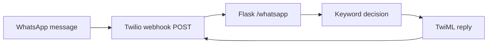

# WhatsApp Keyword Chatbot

A small Flask webhook that turns incoming WhatsApp text into a rule-based reply through Twilio. This learning project demonstrates webhook routing and TwiML responses in a single source file.

**Status:** local webhook verified. A live WhatsApp conversation was not tested in this review.

## What it does

- Responds to `hello`, `help`, `info` and `bye`, with a fallback for other messages.
- Matches keywords case-insensitively in priority order.
- Returns valid TwiML; a missing `Body` now returns the fallback instead of HTTP 500.



## Try it locally

```bash
python -m venv .venv
# Activate your virtual environment
pip install -r requirements.txt
python Coding_For_Whatsapp_chatbot/main.py
```

In another terminal:

```bash
curl -X POST http://127.0.0.1:5000/whatsapp -d "Body=hello"
python -m unittest discover -s tests -v
```

On PowerShell, use `curl.exe` for the curl command. No Twilio credentials are required for the local route test. For phone delivery, configure your own Twilio WhatsApp sandbox and HTTPS webhook as described in the guide.

## Verified result

On 17 October 2026, **3 tests passed**, covering five keyword/fallback examples, missing message content and rejection of GET requests. [Captured responses](docs/results.txt) come from the real Flask test client, with no external messages sent. The missing-body regression was reproduced before the one-line fix.

## Limits

This is a stateless keyword bot. It has no conversation memory, authentication, persistence or Twilio signature validation. The built-in Flask server is for development; request validation and a production host are needed before public use.

## Documentation

- [Detailed setup and implementation guide](docs/PROJECT_GUIDE.md)
- [Verification, environment and evidence](docs/VERIFICATION.md)

Built with Flask and the Twilio Python library. Local recovery codes and configuration are excluded by `.gitignore`.
